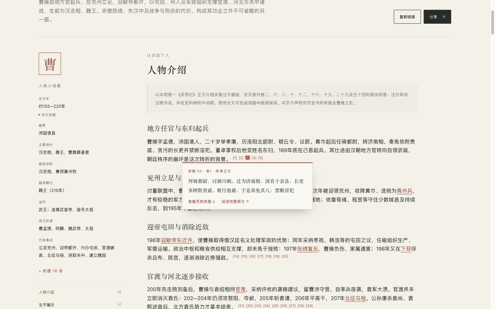
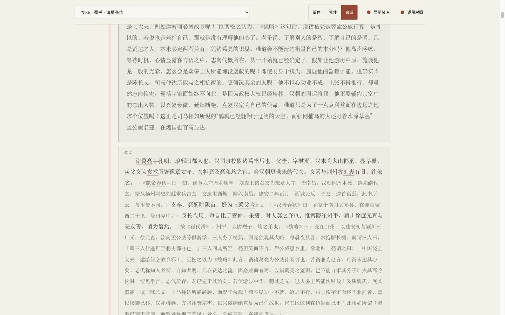

# Sanguozhi · People and Events

[简体中文](README.md) · **English** · [日本語](README.ja.md)

When I told my child stories about the Three Kingdoms, I realized most of what I knew came from the novel *Romance of the Three Kingdoms*, and I couldn't say what had actually happened. So, to teach my child the real history, I built this site: a way into Chen Shou's *Sanguozhi* (*Records of the Three Kingdoms*), with Pei Songzhi's commentary, one person or one event at a time. Read a plain-language profile or event account first, then follow the citation markers back to the exact sentence in the original text and commentary.

**Read online: <https://wolfzl.github.io/sanguozhi/>**

The site itself is in Chinese: the narratives and translations are written in modern Chinese, and the original is Classical Chinese.


## What it is

- **History, not the novel.** Profiles and event pages are written only from the *Sanguozhi* main text and Pei's commentary, never filled in from *Romance of the Three Kingdoms* or film and TV. Where chapters disagree, the accounts are shown side by side.
- **Every claim is sourced.** Each `[n]` marker opens a quotation from the original and links to the paragraph in the full text. A validation script checks at build time that every quotation appears verbatim in the source.
- **The complete book.** All 65 fascicles plus Pei's memorial presenting the commentary, with main text and commentary visually separated and a Simplified/Traditional Chinese toggle.
- **Modern Chinese translation (trial).** All 66 reading units have an AI-assisted vernacular translation that can be read paragraph by paragraph against the original. The translation has not yet been reviewed by a person; treat the original as authoritative.

| People | Events | Original text |
|---|---|---|
| 88 profiles: career timeline, civil and military record, failures and controversies, historians' assessments, relationships, and an itinerary map | 70 events from 184 to 280 CE (26 marked as key), laid out on four parallel tracks (Cao Wei and Jin, Shu Han, Sun Wu, late-Han warlords); Chibi, Guandu and Yiling have step-by-step battle playback | Simplified/Traditional toggle, show/hide commentary, paragraph-level parallel view of translation and original; names of profiled people link to their pages |





## Getting started

Requires Node.js 22.12 or later. Editing the content seeds and running the full test suite also needs Python 3.10 or later.

```bash
npm ci
npm run dev          # dev server: http://127.0.0.1:4321/
npm run build        # validate content → type-check → write dist/
npm run preview      # serve the production build
npm test             # Python and Node unit tests
```

Itinerary maps and battle playback are embedded from [Jiangshan Atlas](https://github.com/DeanChensj/jiangshan-map). The embed points to `http://127.0.0.1:8000/` by default, so you need a separately running copy of Jiangshan Atlas; without it the map frames stay blank and everything else works. To use another address, set the environment variables listed in [.env.example](.env.example) at build time.

## Repository layout

```text
src/
  pages/        home, people, events, reader, about
  components/   UI components
  lib/          data queries, timeline, reader and citation-popover logic
  data/         generated site data: source text (book.json), people and events (cards.json), translations/
scripts/        EPUB extraction, content seeds and generators, validators, browser checks
tests/          Python and Node unit tests
docs/
  guides/       writing and data conventions (profile template, map guide, design notes)
  reviews/      source checks and review records
  audits/       stop-by-stop checks for itinerary maps
  history/      development records
public/         static assets and third-party license texts
```

People and event content lives in Python seed files under `scripts/` (for example `profile_v3_*.py` and `event_content.py`); `scripts/create_cards.py` generates `src/data/cards.json` from them. Edit the seeds, not the generated JSON. See [docs/development.md](docs/development.md) (in Chinese) for the full workflow.

## Feedback

- Please report factual errors, typos or page problems in [Issues](https://github.com/wolfzl/sanguozhi/issues), so others can see and follow them.
- If GitHub isn't convenient, email [wolfzhang008@gmail.com](mailto:wolfzhang008@gmail.com).

## Contributing

Reports of factual errors, typos, wrong links and layout problems are welcome, as are new people and events. Please read [CONTRIBUTING.md](CONTRIBUTING.md) first. The core rule: every statement must be traceable to a sentence in the original text.

## License

This project is dual-licensed:

- **Code** (pages, components, program logic in scripts, tests): [MIT](LICENSE).
- **Text content** (source text, people and event cards, translations, content seed files, documentation): [CC BY-SA 4.0](LICENSE-CONTENT.md). The source text comes from Wikisource; the original work is in the public domain. When you reuse or adapt the content, give attribution, indicate changes, and share under the same license.

[LICENSE-CONTENT.md](LICENSE-CONTENT.md) lists exactly which files count as content. Third-party software and data are listed in [THIRD_PARTY_NOTICES.md](THIRD_PARTY_NOTICES.md).

## Acknowledgements

- *Sanguozhi* by Chen Shou with commentary by Pei Songzhi, from the [Chinese Wikisource](https://zh.wikisource.org/wiki/三國志) transcription and its contributors.
- [Jiangshan Atlas](https://github.com/DeanChensj/jiangshan-map) (DeanChensj, GPL-3.0) for historical maps, personal itineraries and battle playback.
- [OpenCC](https://github.com/BYVoid/OpenCC) and [opencc-js](https://github.com/nk2028/opencc-js) for Simplified/Traditional conversion.
- The [Astro](https://astro.build/) static site framework.
