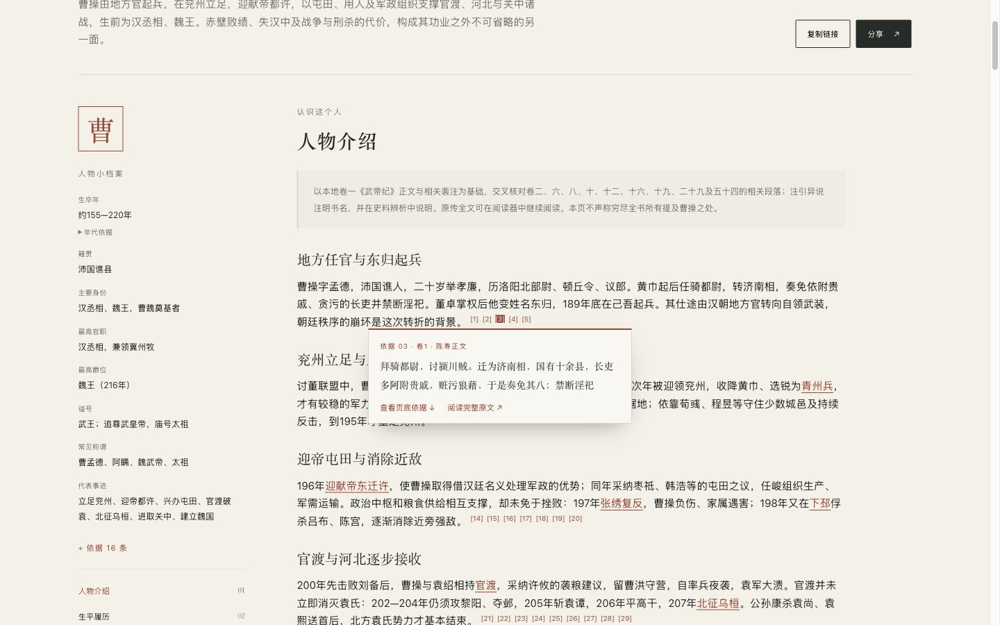
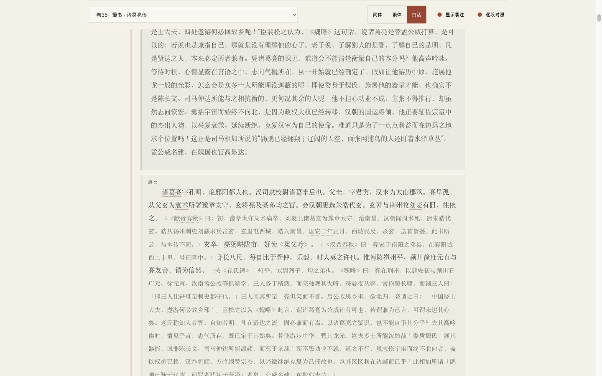

# 三国志 · 人物と事件

[简体中文](README.md) · [English](README.en.md) · **日本語**

子どもに三国の話をしていたとき、自分が語っているのはほとんど『三国志演義』の筋書きで、実際の歴史はよく分かっていないことに気づきました。子どもに正しく伝えたいと思い、このサイトを作りました。陳寿『三国志』（裴松之注）を、一人の人物、一つの出来事から読み進められます。まず人物の小伝や出来事の解説を読み、文中の引用番号をたどって、本文と裴注の原文に戻ることができます。

**オンラインで読む：<https://wolfzl.github.io/>**

サイトの表示言語は中国語です。解説と訳文は現代中国語、原文は漢文です。


## 特徴

- **正史に基づく**：人物と出来事は『三国志』本文と裴注だけに基づいて書いています。『三国志演義』や映像作品の筋書きで史料を補うことはしません。篇によって記述が異なる場合は、それぞれの記述を並べて示します。
- **すべての記述に出典**：解説中の `[n]` を開くと原文の抜粋が表示され、全文の該当段落へ移動できます。ビルド時に検証スクリプトが、すべての引用が原文に一字一句そのまま存在することを確認します。
- **原書をすべて収録**：全 65 巻と「上三国志注表」を収録。本文と裴注を区別して表示し、簡体字・繁体字を切り替えられます。
- **現代語訳（試訳）**：全 66 の閲読単位に、AI の補助による現代中国語の試訳があり、段落ごとに原文と対照できます。訳文はまだ人による校閲を経ていないため、参考用です。原文を優先してください。

| 人物 | 出来事 | 原文 |
|---|---|---|
| 88 人の人物ファイル：経歴、内政と軍事の事績、失策と論争、史家の評価、人物関係、足跡地図 | 184〜280 年の 70 件（うち重要な出来事 26 件）を、曹魏と晋・蜀漢・孫呉・後漢末の群雄の 4 本の線で並べて表示。赤壁・官渡・夷陵は段階ごとの戦況再現つき | 簡体字・繁体字の切り替え、裴注の表示切り替え、現代語訳と原文の段落対照。人物ファイルのある人名から人物ページへ移動可能 |





## はじめかた

Node.js 22.12 以降が必要です。コンテンツの元データを編集したり、すべてのテストを実行したりする場合は Python 3.10 以降も必要です。

```bash
npm ci
npm run dev          # 開発サーバー：http://127.0.0.1:4321/
npm run build        # コンテンツ検証 → 型チェック → dist/ を生成
npm run preview      # ビルド結果をプレビュー
npm test             # Python と Node の単体テスト
```

人物ページの足跡地図と戦況再現には [江山時序 Jiangshan Atlas](https://github.com/DeanChensj/jiangshan-map) を埋め込んでいます。埋め込み先は既定で `http://127.0.0.1:8000/` なので、江山時序を別に起動しておく必要があります。起動していない場合、地図の枠は空白になりますが、ほかの内容には影響しません。別のアドレスを使うには、ビルド時に [.env.example](.env.example) の環境変数を設定してください。

## ディレクトリ構成

```text
src/
  pages/        ページ：トップ、人物、出来事、原文閲読、このサイトについて
  components/   画面部品
  lib/          データ検索、年表、閲読画面、引用ポップアップなどの処理
  data/         生成済みデータ：原文（book.json）、人物と出来事（cards.json）、現代語訳（translations/）
scripts/        原文抽出、コンテンツの元データと生成スクリプト、検証、ブラウザチェック
tests/          Python と Node の単体テスト
docs/
  guides/       執筆とデータの規約（人物ファイルのテンプレート、地図ガイド、設計メモ）
  reviews/      史料の照合と確認の記録
  audits/       足跡地図の地点ごとの照合データ
  history/      開発記録
public/         静的ファイルと第三者ライセンス文書
```

人物と出来事の内容は `scripts/` 内の Python ファイル（`profile_v3_*.py`、`event_content.py` など）に書かれており、`scripts/create_cards.py` がそこから `src/data/cards.json` を生成します。生成された JSON ではなく、元のファイルを編集してください。詳しい手順は [docs/development.md](docs/development.md)（中国語）を参照してください。

## フィードバック

- 史料の誤り、誤字、表示の不具合は [Issues](https://github.com/wolfzl/wolfzl.github.io/issues) でお知らせください。ほかの方にも見えて、対応状況を追えます。
- GitHub を使いにくい場合は [wolfzhang008@gmail.com](mailto:wolfzhang008@gmail.com) までメールでどうぞ。

## コントリビューション

史料の誤り、誤字、リンク誤り、表示の不具合の報告を歓迎します。人物や出来事の追加も歓迎します。まず [CONTRIBUTING.md](CONTRIBUTING.md) をお読みください。いちばん大切な決まりは、すべての記述を原文の一文までたどれるようにすることです。

## ライセンス

このプロジェクトは二つのライセンスで提供しています。

- **コード**（ページ、部品、スクリプト中のプログラム、テスト）：[MIT](LICENSE)
- **テキスト**（原文、人物と出来事のカード、現代語訳、コンテンツの元データ、ドキュメント）：[CC BY-SA 4.0](LICENSE-CONTENT.md)。原文はウィキソースから取得しており、原著はパブリックドメインです。再利用や改変の際は、出典を表示し、変更点を明記し、同じライセンスで共有してください。

どのファイルが「テキスト」に当たるかは [LICENSE-CONTENT.md](LICENSE-CONTENT.md) に記載しています。利用している第三者のソフトウェアとデータは [THIRD_PARTY_NOTICES.md](THIRD_PARTY_NOTICES.md) をご覧ください。

## 謝辞

- 陳寿撰・裴松之注『三国志』、[中国語版ウィキソース](https://zh.wikisource.org/wiki/三國志) の入力テキストとその貢献者の皆さま。
- 歴史地図、人物の足跡、戦況再現を提供する [江山時序 Jiangshan Atlas](https://github.com/DeanChensj/jiangshan-map)（DeanChensj、GPL-3.0）。
- 簡体字・繁体字の変換に使用している [OpenCC](https://github.com/BYVoid/OpenCC) と [opencc-js](https://github.com/nk2028/opencc-js)。
- 静的サイトフレームワーク [Astro](https://astro.build/)。
