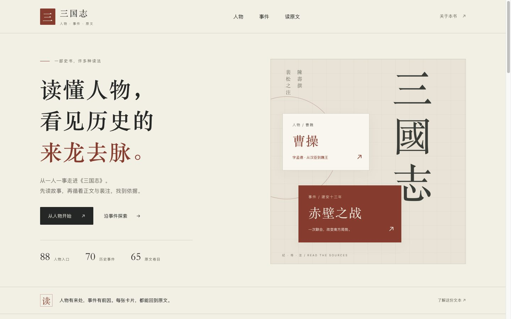
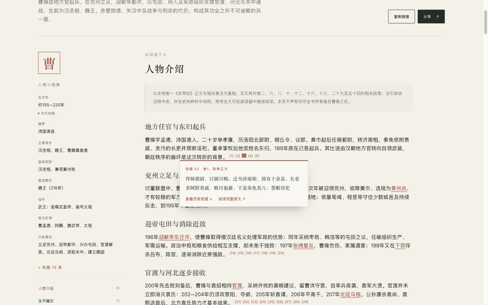
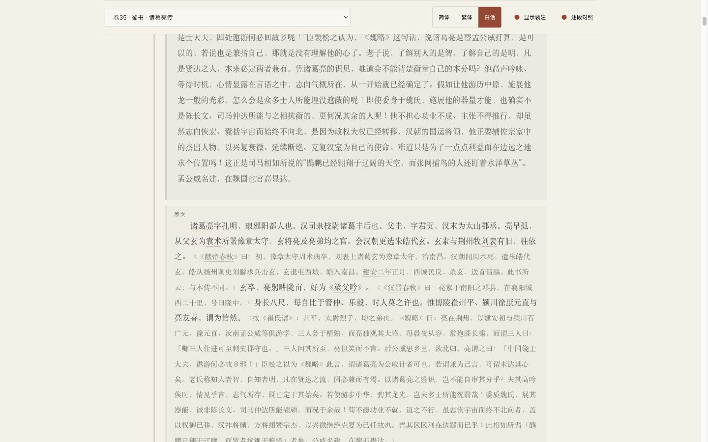

# 三国志 · 人物与事件

**简体中文** · [English](README.en.md) · [日本語](README.ja.md)

给孩子讲三国故事的时候，我发现自己讲的多半是《三国演义》里的情节，真实的历史反而说不清楚。为了给孩子讲对，我做了这个网站：从一个人、一件事读进陈寿《三国志》（裴松之注）。先读人物小传和事件解读，再顺着每句话后面的引用编号，回到正文与裴注的原句。

**在线阅读：<https://wolfzl.github.io/sanguozhi/>**



## 这个项目是什么

- **以正史为准**：人物和事件只依据《三国志》正文与裴注写成，不用《三国演义》或影视情节补写史料。不同篇章说法不一时并列呈现，不替读者下定论。
- **每句话都有出处**：讲解里的 `[n]` 角标点开就是原文摘录，可以继续跳到全文中的对应段落。构建时有校验脚本逐条确认每段引文确实出现在原文里。
- **原书完整可读**：65 卷及《上三国志注表》全文，正文与裴注分层显示，可在简体、繁体之间切换。
- **白话试译**：全书 66 个阅读单元都提供 AI 辅助的白话试译，可以逐段与原文对照。译文尚待人工审阅，仅供参考，以原文为准。

| 人物 | 事件 | 原文 |
|---|---|---|
| 88 位人物档案：生平履历、文治武功、失误与争议、史家评价、人物关系、行迹地图 | 184—280 年间 70 个事件（26 个关键事件），按曹魏与晋、蜀汉、孙吴、汉末诸侯四条线并行展示；赤壁、官渡、夷陵附分阶段推演 | 简繁切换、裴注显示开关、白话逐段对照；正文中已建档的人名可以直接跳到人物页 |





## 快速开始

需要 Node.js 22.12 或更新版本；修改内容种子和运行全部测试还需要 Python 3.10 以上。

```bash
npm ci
npm run dev          # 开发预览：http://127.0.0.1:4321/
npm run build        # 校验内容 → 类型检查 → 生成 dist/
npm run preview      # 预览构建结果
npm test             # Python 与 Node 单元测试
```

人物页的行迹地图和战役推演嵌入了 [江山时序](https://github.com/DeanChensj/jiangshan-map)。地图默认连接 `http://127.0.0.1:8000/`，需要另外运行一份江山时序；没有运行时，地图区域显示为空白，其余内容不受影响。构建时可以用环境变量改成其他地址，见 [.env.example](.env.example)。

## 目录结构

```text
src/
  pages/        页面：首页、人物、事件、原文阅读、关于
  components/   页面组件
  lib/          数据查询、时间线、阅读器、引用浮层等逻辑
  data/         生成好的站点数据：原文（book.json）、人物与事件（cards.json）、白话译文（translations/）
scripts/        原文提取、内容种子与生成器、校验脚本、浏览器检查
tests/          Python 与 Node 单元测试
docs/
  guides/       写作与数据规范（人物卡模板、行迹地图指南、设计说明）
  reviews/      史料核对与验收记录
  audits/       行迹地图的逐站核对数据
  history/      开发过程记录
public/         静态资源与第三方许可文本
```

人物与事件的内容写在 `scripts/` 下的 Python 种子文件里（如 `profile_v3_*.py`、`event_content.py`），由 `scripts/create_cards.py` 生成 `src/data/cards.json`。请修改种子文件，不要直接改生成结果。完整流程见 [docs/development.md](docs/development.md)。

## 反馈

- 发现史料错误、错别字或页面问题，欢迎在 [Issues](https://github.com/wolfzl/sanguozhi/issues) 提出，方便大家看到并跟踪处理。
- 不方便使用 GitHub 的话，也可以发邮件到 [wolfzhang008@gmail.com](mailto:wolfzhang008@gmail.com)。

## 参与贡献

欢迎指出史料错误、错别字、误链和页面问题，也欢迎补充人物和事件。请先读 [CONTRIBUTING.md](CONTRIBUTING.md)：最重要的规则是每一条叙述都要能落到原文中的一句话。

## 许可

本项目采用双许可：

- **代码**（页面、组件、脚本中的程序逻辑、测试）：[MIT](LICENSE)。
- **文本内容**（原文、人物与事件卡片、白话译文、内容种子文件、文档）：[CC BY-SA 4.0](LICENSE-CONTENT.md)。原文取自维基文库，原著属于公有领域；本站整理的内容按同一许可提供，转载或改编时请署名、注明修改并以相同许可分享。

哪些文件属于“内容”见 [LICENSE-CONTENT.md](LICENSE-CONTENT.md)。本项目用到的第三方软件与数据见 [THIRD_PARTY_NOTICES.md](THIRD_PARTY_NOTICES.md)。

## 致谢

- 陈寿撰、裴松之注《三国志》，[维基文库](https://zh.wikisource.org/wiki/三國志) 网络录入本及其贡献者。
- [江山时序 Jiangshan Atlas](https://github.com/DeanChensj/jiangshan-map)（DeanChensj，GPL-3.0）提供历史地图、人物路线与战役推演。
- [OpenCC](https://github.com/BYVoid/OpenCC) 与 [opencc-js](https://github.com/nk2028/opencc-js) 提供简繁转换。
- [Astro](https://astro.build/) 静态站点框架。
